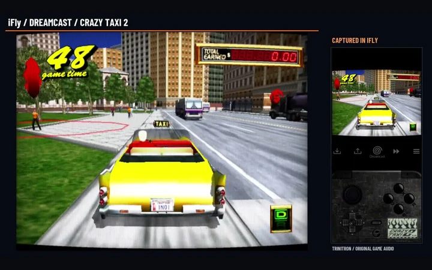
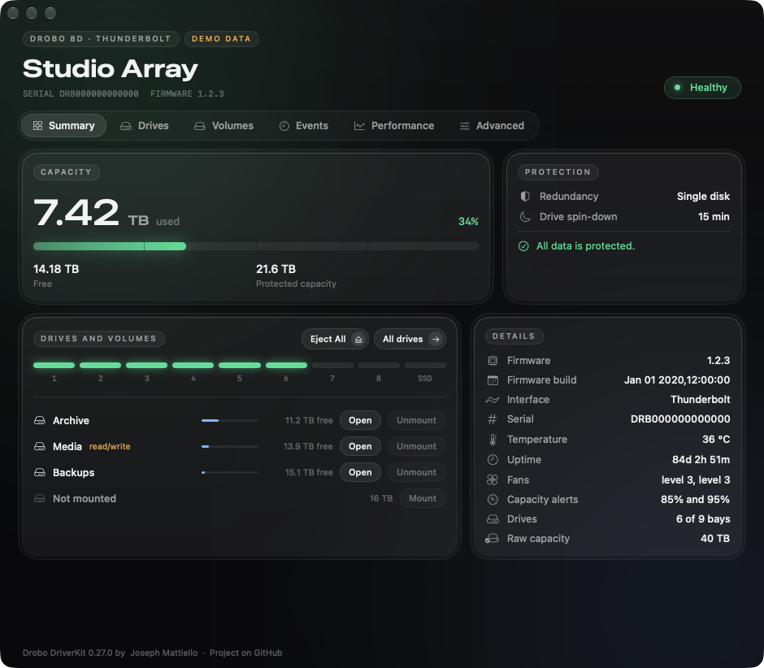
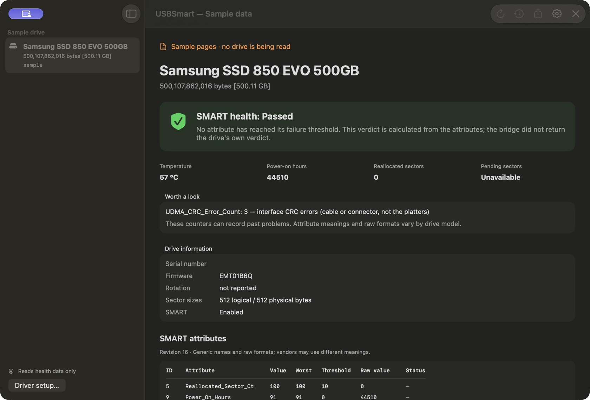

<h1 align="center">Joseph Mattiello</h1>

  <strong><a href="https://joemattiello.dev/#experience">Engineering leader</a> · <a href="https://joemattiello.dev/#skills">Mobile architecture and systems engineering</a> · <a href="https://joemattiello.dev/ai/">AI/LLM tooling</a></strong> 
  NYC · <a href="https://joemattiello.dev/#experience">18+ years in mobile and enterprise POSIX/Unix systems</a> · <a href="#us-patents">3 US patents in ML/AI</a>

  <strong><a href="mailto:mail@joemattiello.com">Hiring? Get in touch</a> · <a href="https://github.com/JoeMatt">Follow on GitHub</a></strong> 
  <a href="#other-engineering-work">Systems projects</a> · <a href="https://joemattiello.dev/#impact">Case studies</a> · <a href="#open-source-highlights">Open source</a> · <a href="#press--recognition">Press</a> · <a href="https://www.linkedin.com/in/joemattiello/">LinkedIn</a> · <a href="https://joemattiello.dev/consulting/">Consulting</a>

## Emulators

I created Provenance EMU, iFly, and iCube, and maintain the Virtual Jaguar libretro core.

<table>
  <tr>
    <td width="50%" valign="top">
       
      <strong><a href="https://provenance-emu.com/">Provenance EMU</a></strong> · Sonic Advance 3 
      Multi-system emulator for Apple platforms. <a href="https://apps.apple.com/us/app/provenance-app/id1596862805">App Store</a> · <a href="https://github.com/Provenance-Emu/Provenance">Source and 6.4k GitHub stars</a>
    </td>
    <td width="50%" valign="top">
       
      <strong><a href="https://ifly-emu.com/">iFly</a></strong> · Crazy Taxi 2 
      Dreamcast emulation. <a href="https://ifly-emu.com/#gameplay">Gameplay</a>
    </td>
  </tr>
  <tr>
    <td width="50%" valign="top">
       
      <strong><a href="https://icube-emu.com/">iCube</a></strong> · Super Smash Bros. Melee 
      GameCube and Wii emulation. <a href="https://icube-emu.com/#gameplay">Gameplay</a>
    </td>
    <td width="50%" valign="top">
       
      <strong><a href="https://jaguar.provenance-emu.com/app.html">Virtual Jaguar</a></strong> · Blue Lightning 
      Atari Jaguar and Jaguar CD emulation. <a href="https://github.com/libretro/virtualjaguar-libretro#credits-and-license">Libretro core I maintain</a>
    </td>
  </tr>
</table>

## Other engineering work

- **[Drobo DriverKit](https://github.com/JoeMatt/drobo-driverkit)** · DriverKit driver and dashboard for the Drobo 8D Thunderbolt array on Apple silicon. Reads verified. Writes are experimental. [Project page](https://joemattiello.dev/drobo-driverkit/).
- **[USBSmart](https://joemattiello.dev/usbsmart/)** · Read-only USB SATA drive health on Apple silicon, with a macOS menu bar monitor and [Prometheus metrics](https://github.com/JoeMatt/usbsmart/releases/tag/v0.5.1).
- **[Wayfair mobile infrastructure](https://joemattiello.dev/#impact)** · Built a video compression and caching pipeline with an estimated **$2M/year** in bandwidth savings.

Drobo DriverKit screenshot

   
  Drobo DriverKit dashboard with built-in demo data.

USBSmart screenshot

   
  <a href="https://github.com/JoeMatt/usbsmart/releases/tag/v0.5.1">USBSmart 0.5.1</a> displaying a saved hardware scan.

---

### About

I started writing iOS apps [before Apple released the SDK](https://joemattiello.dev/#about), hacking together Objective-C on jailbroken hardware. I work on [Wayfair’s App Infrastructure team](https://joemattiello.dev/#impact) and previously directed [iOS Platform at NewsCorp](https://joemattiello.dev/#experience) across eight regions. I’m a named inventor on [three US patents](#us-patents) from Sense Networks, covering location analytics and event detection.

[Live site metrics](https://joemattiello.dev/status/) · [Stack Overflow](https://stackoverflow.com/users/3412622/joem)

---

### Currently building

- **[Provenance](https://github.com/Provenance-Emu/Provenance)** — multi-system iOS/tvOS/macOS emulator, App Store launch Jan 2025, 6.4k GitHub stars, 79 contributors, 9.3k Discord members, 388k+ GitHub release downloads
- **[Multi-agent CI orchestration](https://joemattiello.dev/ai/)** across the Provenance org — Claude (Sonnet+Opus auto-routed by static diff analysis) + Cursor + Kimi sharing one dispatch vocabulary. [Case study →](https://joemattiello.dev/#impact)
- **[Atari Jaguar 240p Test Suite](https://github.com/JoeMatt/atari_jaguar_240p_test_suite)** — bare-metal m68k port of Artemio Urbina's 240p Test Suite. Built end-to-end with Claude Code + Copilot/Qodo as adversarial reviewers. **36 PRs in 10 days, ~84% AI co-authored.** [PR #27 (PAL pass)](https://github.com/JoeMatt/atari_jaguar_240p_test_suite/pull/27) · [smoke-test CI](https://github.com/JoeMatt/atari_jaguar_240p_test_suite/blob/main/.github/workflows/build.yml)
- **[virtualjaguar-libretro](https://github.com/libretro/virtualjaguar-libretro)** — maintainer; first open-source Atari Jaguar CD emulation. 28 merged PRs.
- **[AI tooling at Wayfair](https://joemattiello.dev/ai/)** — custom MCP servers, Claude skills/plugins, n8n workflows for the App Infrastructure team supporting 60+ mobile engineers

---

GitHub activity

  

### Open source highlights

| Repo | Stars | Role | What it is |
|---|---|---|---|
| [**Provenance-Emu/Provenance**](https://github.com/Provenance-Emu/Provenance) |  | Creator · Lead | iOS/tvOS/macOS multi-system emulator. App Store. |
| [**HeroTransitions/Hero**](https://github.com/HeroTransitions/Hero) |  | Admin · Maintainer | Custom view-controller transitions for Swift. |
| [**libretro/virtualjaguar-libretro**](https://github.com/libretro/virtualjaguar-libretro) |  | Maintainer | First OSS Atari Jaguar CD emulation. |
| [**JoeMatt/atari_jaguar_240p_test_suite**](https://github.com/JoeMatt/atari_jaguar_240p_test_suite) |  | Maintainer · AI-built | Bare-metal m68k Jaguar — built with Claude Code. |
| [**RxSwiftCommunity/RxRealm**](https://github.com/RxSwiftCommunity/RxRealm) |  | Maintainer | RxSwift bindings for Realm. |
| [**CoreOffice/XMLCoder**](https://github.com/CoreOffice/XMLCoder) |  | Major contributor | Codable XML parsing in Swift. |

**Other notable contributions:** [RetroArch](https://github.com/libretro/RetroArch) (Apple platform drivers — camera, microphone, CoreMIDI, CoreLocation) · [SideStore](https://github.com/SideStore/SideStore) (org member, 21 merged PRs) · [swift-corelibs-foundation](https://github.com/swiftlang/swift-corelibs-foundation) · [Mono / Xamarin](https://www.mono-project.com/) (CoreMIDI, CoreAudio, Foundation C# wrappers for MonoMac) · [GLideN64](https://github.com/gonetz/GLideN64) · [mupen64plus-core](https://github.com/mupen64plus/mupen64plus-core) · [UTM](https://github.com/utmapp/UTM)

---

### Press & recognition

- **[mobilegamer.biz](https://mobilegamer.biz/emulation-arrived-on-the-app-store-two-years-ago-60m-downloads-later-whats-changed/)** (Apr 2026) — featured developer interview in the 2-year App Store emulator retrospective
- **[9to5Mac](https://9to5mac.com/2024/04/19/provenance-playstation-emulator-app-store/)**, **[iMore](https://www.imore.com/gaming/the-provenance-playstation-nintendo-and-atari-game-emulator-is-now-available-for-beta-download-on-iphone-and-ipad-and-an-apple-tv-version-is-next)** (exclusive), **[Time Extension](https://www.timeextension.com/news/2024/05/multi-console-emulator-provenance-coming-the-iphone-app-store-nintendo-be-damned)**, **[Android Authority](https://www.androidauthority.com/provenance-app-store-3435686/)**, **[AppleInsider](https://appleinsider.com/articles/24/04/19/provenance-plans-to-bring-sony-sega-console-emulation-to-the-app-store)**, **[Pocket Gamer](https://www.pocketgamer.com/provenance/)** (dedicated hub)
- **YouTube coverage:** [TWiT](https://www.youtube.com/@twit) (2.3M subs), [ETA PRIME](https://www.youtube.com/@etaprime) (2.2M), [Spawn Wave](https://www.youtube.com/@SpawnWaveMedia)
- **Earlier:** Newsweek cover ("The Next Google" — Sense Networks, 2009), Bloomberg Businessweek "25 Most Intriguing Startups", New York Times, CNN Money

---

### US patents

- [**US 8,224,766**](https://patents.google.com/patent/US8224766B2) — Comparing spatial-temporal trails in location analytics
- [**US 8,620,624**](https://patents.google.com/patent/US8620624B2) — Event identification in sensor analytics
- [**US 9,571,962**](https://patents.google.com/patent/US9571962B2) — System and method of performing location analytics

Patent portfolio acquired twice — by YP/YellowPages in 2014, then by Verve in 2017.

---

### Get in touch

| If you're… | Best path |
|---|---|
| **Hiring** for Head of AI Platform / VP Eng / Director / CTO | [LinkedIn DM](https://www.linkedin.com/in/joemattiello/) |
| **Looking for a consultant** for a Mobile AI Launch Readiness Audit | [joemattiello.dev/consulting/](https://joemattiello.dev/consulting/) |
| **Curious how I work** | [Case studies](https://joemattiello.dev/#impact) (Wayfair · NewsCorp · Cameo · AI multi-agent CI) |
| **Press, podcasting, or speaking** | [LinkedIn](https://www.linkedin.com/in/joemattiello/) or [joemattiello.dev](https://joemattiello.dev) |

Site, status dashboard, and consulting offer are all open source — see <a href="https://github.com/JoeMatt/joematt.github.io">joematt.github.io</a>.
